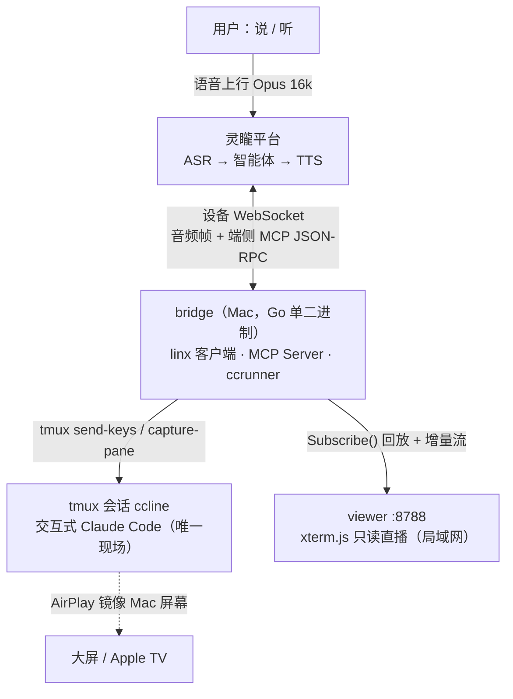
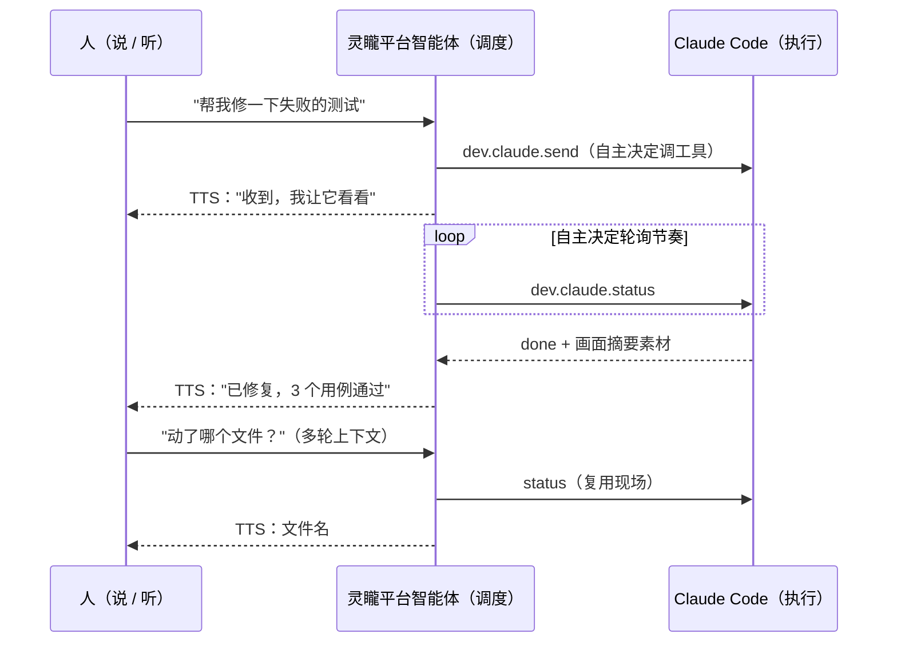

<p align="center">
  
</p>

[](https://github.com/huaiyuWangh/Hackathon2026/actions/workflows/ci.yml)
[](https://codecov.io/gh/huaiyuWangh/Hackathon2026)

**VoiceCopilot** —— Hackathon2026 参赛项目，基于灵矓（Qiniu Xrobot）平台的语音编程副驾驶。
对着任意灵矓语音入口说一句"帮我修一下失败的测试"，Mac 上的 Claude Code 就开始干活，
大屏实时看它写代码，结果由语音读给你听。

📺 演示视频：
- [语音端到端闭环](docs/media/demo-voice-e2e-2026-10-23.mp4)（77s，语音驱动 CC + 多轮工具调用）
- [手机网页查看器](docs/media/demo-viewer-phone-2026-10-24.mp4)（手机浏览器实时看 CC 现场，局域网直连）

## 为什么需要它

- CI 挂了，人却不在电脑前——以前只能干等回家；
- AI 写代码再快，也还是要你坐在屏幕前盯着它跑；
- 长任务跑完了没人告诉你结果，回头全靠自己翻终端。

VoiceCopilot 把 AI 编程从键盘前解放出来：**嘴下指令、耳朵听结果、眼睛随时看**。
不依赖任何屏幕即可完整工作；屏幕（大屏/手机）只是锦上添花。

## 一图看懂

三条各司其职的通道——语音（意图与播报）、控制（端侧 MCP 工具调用）、显示（AirPlay/网页直播）：



两个 AI 智能体分层协作——**Agent 指挥 Agent，人只负责说和听**：



## 三大能力

| 能力 | 说明 |
|------|------|
| 🎙️ 语音下发 | 灵矓智能体理解意图后调用端侧工具 `dev.claude.send`，异步任务对（send/status/interrupt）撑住分钟级长任务；危险操作先语音确认 |
| 👀 实时观看 | AirPlay 大屏镜像 + 手机网页直播（`:8788/viewer`，xterm.js 全内嵌离线可用）双冗余，局域网内扫码即看 |
| 🔊 播报与追问 | 执行结果摘要成两三句人话 TTS 播报——嘴说概要、眼看细节；支持多轮追问与随时打断 |

## 一个场景

> 下班的地铁上，手机弹出 CI 告警。你掏出手机对灵矓入口说："看看 CI 为什么挂了，能修就修。"
> 智能体应了一声"收到"，你 Mac 里的 Claude Code 已经开始读代码、跑测试。
> 你顺手把手机递给旁边的朋友看直播画面。两站地铁后，耳机里传来：
> "测试修复了，3 个用例通过，改了 2 个文件。" 你问："动了哪个文件？"
> "payment 下的 refund.go。" ——到家前，测试已经绿了。

## 技术架构

Go 单二进制 `bridge` 作为**灵矓设备**接入（端侧 MCP Server），依赖单向
`linx → mcp → tools → ccrunner`，`viewer/webui → ccrunner`。关键设计：异步工具对、
tmux 会话是唯一现场、传输无关 ToolProvider（预留云端 MCP 出口）、双端口隔离
（控制面 8787 仅本机 / 只读直播 8788 上局域网）。

架构全文与决策记录见 [docs/architecture.md](docs/architecture.md)；
更详细的架构论述与工程深挖见 issue 系列
[Architecture: 总体架构](https://github.com/huaiyuWangh/Hackathon2026/issues/5) ·
[M4 查看器](https://github.com/huaiyuWangh/Hackathon2026/issues/6) ·
[关键工程问题](https://github.com/huaiyuWangh/Hackathon2026/issues/7)。

## 接入真实平台（M3+M5 语音闭环）

```sh
cp .env.example .env   # 填入 BRIDGE_API_KEY（灵矓控制台）；BRIDGE_AUDIO=1 开语音
brew install portaudio opus opusfile   # 音频依赖（一次性）
make build

bin/bridge --local mic-test   # 首次运行触发麦克风授权弹窗, 确认"正常收音"
bin/bridge serve              # 在你自己的终端里跑（麦克风权限归属终端 App）
```

启动后：

- **控制页** http://127.0.0.1:8787/ —— 大按钮开关麦克风（默认关闭），点亮后对着 Mac 说话
- **查看器** http://<Mac局域网IP>:8788/viewer —— 手机/任意浏览器实时看 CC 现场
  （xterm.js 终端镜像，只读、离线可用）
- 语音链路：Mac 麦克风 → 灵矓 ASR/智能体（realtime 模式，服务端 VAD）→
  端侧工具 `dev.claude.*` → tmux 里的 Claude Code 干活 → 结果 TTS 从 Mac 播报
- 看现场：`tmux attach -t ccline`（退出 `Ctrl+b` 再按 `d`）

## 快速开始（本地调试，不依赖平台）

```sh
make build
bin/bridge --local tools list
bin/bridge --local tools call dev.claude.send --arg 'prompt=修复登录测试'
make test
```

平台消息格式模拟（M2）：stdin 逐行喂灵矓外层消息，走完整协议链路——

```sh
echo '{"type":"mcp","payload":{"jsonrpc":"2.0","id":1,"method":"tools/list"}}' | bin/bridge --local sim
echo '{"type":"mcp","payload":{"jsonrpc":"2.0","id":2,"method":"tools/call","params":{"name":"dev.claude.send","arguments":{"prompt":"只回复: ok"}}}}' | bin/bridge --local sim
echo '{"type":"mcp","payload":{"jsonrpc":"2.0","id":3,"method":"tools/call","params":{"name":"dev.claude.status"}}}' | bin/bridge --local sim
```

> M1 起 `tools call` 为真实链路（tmux 里跑交互式 Claude Code），想看现场：
> `tmux attach -t ccline`（退出按 `Ctrl+b` 再按 `d`）。

## 项目结构

```
cmd/bridge/       入口：装配 + --local 调试 CLI（tools/sim/mic-test/play-test）
internal/linx/    灵矓设备协议客户端 + 音频(PortAudio/Opus) + MCP Proxy 备用通道
internal/mcp/     MCP 协议分发（JSON-RPC）+ HTTP/SSE 传输
internal/tools/   业务工具 dev.claude.send / status / interrupt
internal/ccrunner/  CC 运行时：tmux 驱动 + 任务状态机 + 现场订阅（核心）
internal/viewer/  网页查看器：xterm.js 终端直播（局域网 8788, 只读）
internal/webui/   麦克风控制页（本机 8787, go:embed 单页）
internal/brand/   VoiceCopilot 品牌资产（图标）
internal/config/  运行配置（环境变量 + .env）
```

依赖方向单向：`linx → mcp → tools → ccrunner`。

## 里程碑与下一步

| 阶段 | 内容 | 状态 |
|------|------|------|
| M0 | 骨架 + config + --local CLI | ✅ |
| M1 | ccrunner：tmux 驱动交互式 CC | ✅ |
| M2 | mcp 协议 + tools 本地全链路（--local sim 平台模拟） | ✅ |
| M3 | linx 客户端接入灵矓平台 + 智能体联调 | ✅ |
| M4 | 方案B 网页查看器（局域网只读直播） | ✅ |
| M5 | Mac 音频入口（realtime）+ 控制页 | ✅ 端到端闭环验证通过（2026-10-23，含多轮工具调用） |

下一步（详见 [Proposal: 商业画布与 Roadmap](https://github.com/huaiyuWangh/Hackathon2026/issues/3)）：
M6 任务驾驶舱（控制页升级任务卡片与历史）→ M7 灵矓小程序语音入口 → M8 技能 SDK
（`dev.git.*` / `dev.docker.*`，从"一个技能"到"技能平台"）→ M9 云端 MCP 通道 → M10 团队版。

## 更多材料

- 产品定位与商业叙事：[docs/pitch.md](docs/pitch.md) · [Proposal: 定位与命名](https://github.com/huaiyuWangh/Hackathon2026/issues/1)
- 3 分钟演示剧本：[docs/demo-script.md](docs/demo-script.md)
- AI 元素盘点与答辩话术：[AI Value](https://github.com/huaiyuWangh/Hackathon2026/issues/8) ·
  AI 工程效率证据包：[AI Efficiency](https://github.com/huaiyuWangh/Hackathon2026/issues/9)
- 品牌资产（logo/色板）：[docs/brand/](docs/brand/)
